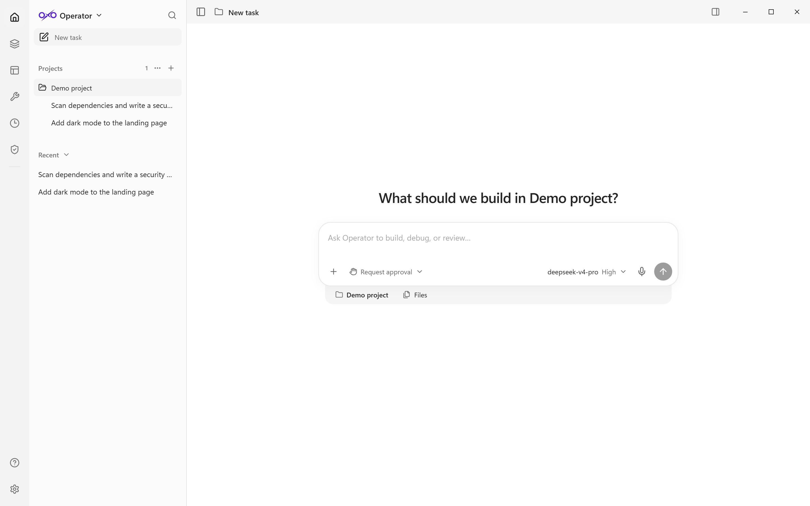
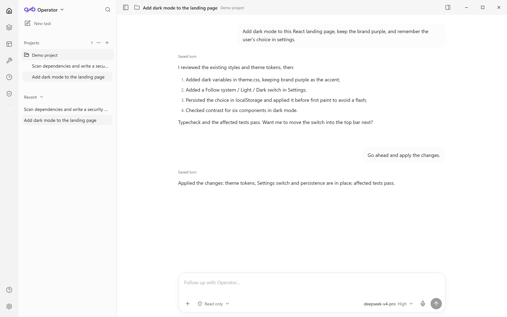
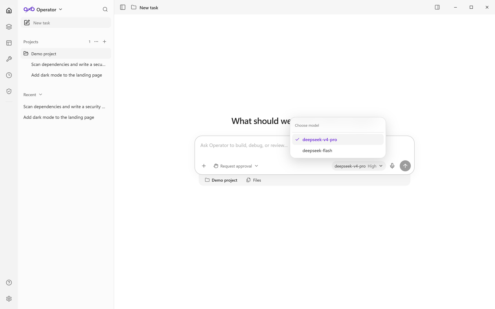
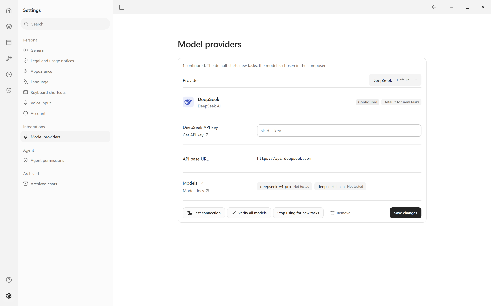
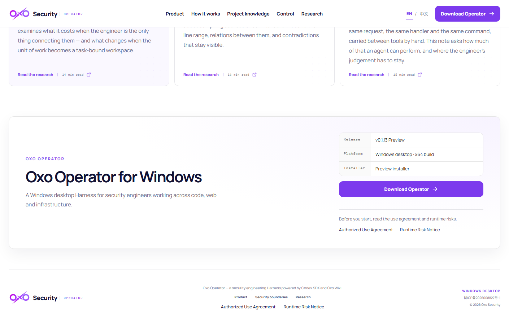

# 🧭 Oxo Operator

### Local-first AI coding & security workbench for Windows — with your own model API key

**Ask in plain language, and let the agent edit code, run commands, read the web, test APIs and scan dependencies — inside one desktop window, on your own PC.**

**English** · [🇨🇳 中文](README.zh-CN.md)

[⬇️ Download latest](https://github.com/Oxo-AI-Security/Oxo-Operator-Releases/releases/latest) &nbsp;•&nbsp; [🚀 Quick start](#-quick-start-in-5-minutes) &nbsp;•&nbsp; [🤖 Supported models](#-supported-models--api-keys) &nbsp;•&nbsp; [🖼️ Screenshots](#-screenshots) &nbsp;•&nbsp; [❓ FAQ](#-faq--troubleshooting)

---

## 👋 What is Oxo Operator?

**Oxo Operator is a desktop AI coding and security workbench for Windows.** It runs the Codex agent runtime locally and connects it to the model provider **you** choose — DeepSeek, Kimi, Qwen, OpenAI, Azure OpenAI or a compatible custom endpoint — using **your own API key**.

Ask for a change in plain language. The agent reads your project, plans the work, edits files, runs commands and tests, and keeps you in control with an approval card before anything risky.

- 🧠 *“Can an AI actually fix this failing test in my project?”* — yes, and you see every file change.
- 🌐 *“What does this web page say?”* — open it in the built-in browser and ask follow-up questions.
- 🧪 *“Is this API returning what I expect?”* — build, replay and inspect HTTP requests, then hand the response to the agent.
- 🛡️ *“Are there vulnerable dependencies here?”* — run security scans and get a report you can review.

> 💡 **New to AI agents?** Start with the [5-minute quick start](#-quick-start-in-5-minutes). You only need Windows and an API key from one supported provider — no coding, GPU or local model required.

---

## ✨ What you can do

| | Feature | What it means for you |
|---|---|---|
| 🧠 | **Agentic coding** | Describe a task; the agent inspects the project, edits files, runs commands and tests, and streams its progress. |
| 💬 | **Tasks & sessions** | Every task is saved locally with its history. Go back, continue, or search all conversations. |
| 🔍 | **Change review** | Per-turn file-change summaries and diffs, so you can review before accepting anything. |
| 🌐 | **Built-in browser** | Open pages, select and annotate regions, take screenshots, and use the page as context. |
| 🧪 | **HTTP request workspace** | Author and replay requests, inspect traffic, and send request/response context to the agent. |
| 📚 | **Knowledge base** | Import your docs into spaces and let the agent answer from them. |
| 🧩 | **Plugins & tools** | GitHub, Jira, local Git, security scanners (nuclei / Trivy / Semgrep / ZAP) and more. |
| 🖥️ | **Computer Use** | With your explicit approval, control native windows for click-and-type tasks. |
| 🧱 | **Custom components** | Turn recurring tasks into panels you can place on a workbench and refresh on a schedule. |
| 🛡️ | **Approval gate** | Deleting files, changing the system or sending risky requests asks for approval in the conversation. |
| 🎙️ | **Voice input** | A local speech model turns dictation into composer text. |
| 🌗 | **Theme & language** | Light/dark themes and a Chinese/English interface. |

---

## 📸 Screenshots

### 🧭 New task — pick a project, describe the goal

### 💬 Conversation — plans, edits and results with your approval

### 🤖 Choose the model and reasoning effort

### 🔌 Connect your own provider with an API key

### ⬇️ Official download page

---

## 🚀 Quick start in 5 minutes

### 1️⃣ Download the installer

Open **[Releases](https://github.com/Oxo-AI-Security/Oxo-Operator-Releases/releases/latest)** and download `Oxo-Operator-<version>-x64.exe` from the **Assets** section. The same installer is published on the official site: <https://oxosecurity.com/?lang=en#download>.

Each release also includes:

- `*.sha256` — checksum for the installer;
- `BUILD-INFO.json` — build identity and update feed;
- `RELEASE-NOTES.md` — what changed;
- `THIRD-PARTY-NOTICES.txt` — third-party licence notices.

### 2️⃣ Install and launch

Run the `.exe` and follow the installer. On first launch, read and accept the authorized-use agreement and runtime risk notice.

> ⚠️ **Windows SmartScreen:** this Preview is not Authenticode-signed. Choose **More info → Run anyway**, and compare the installer SHA-256 with the release's `*.sha256` asset if you want to be sure.

### 3️⃣ Connect your model (API key)

1. Open **⚙️ Settings → Integrations → Model providers**.
2. Pick your provider (for example **DeepSeek**).
3. Create an API key in the provider's console and paste it into the **API Key** field.
4. Click **Save**, then **Set as default** so new tasks use it.

> 🔐 The key is encrypted by the app's main process with Windows secure storage. The UI never receives the plaintext, and the key is only sent to the provider you chose — never to Oxo.

### 4️⃣ Choose a model

In the new-task composer, click the model button at the bottom-right and choose a model and reasoning effort.

### 5️⃣ Start your first task

Describe the goal and press **Enter**. The agent plans, reads files and runs commands; risky actions will ask for approval.

| | Try saying |
|---|---|
| 🛠️ | “Fix the failing `pnpm test` in this project and explain the cause.” |
| 🎨 | “Add a dark-mode switch to the settings page and keep the brand purple.” |
| 🧪 | “Write five edge-case tests for the login API and make them pass.” |
| 🛡️ | “Scan frontend dependencies for known vulnerabilities and write a client-ready report.” |
| 🌐 | “Open the project docs page, summarize the install steps and turn them into a README.” |

---

## 🤖 Supported models & API keys

| Provider | Common models | Where to create the API key |
|---|---|---|
| 🐋 **DeepSeek** | `deepseek-v4-pro`, `deepseek-flash` | <https://platform.deepseek.com/api_keys> |
| 🌙 **Kimi (Moonshot)** | `kimi-k3` | <https://platform.moonshot.cn/console/api-keys> |
| ☁️ **Qwen (Alibaba Cloud)** | `qwen3.8-max`, `qwen3.8-flash`, `qwen3.7-plus`, `qwen3.7-flash` | <https://dashscope.console.aliyun.com/apiKey> |
| 🤖 **ChatGPT / OpenAI** | `gpt-6.1-sol`, `gpt-6-astra`, `gpt-6-luna` | <https://platform.openai.com/api-keys> |
| 🏢 **Azure OpenAI** | Your deployment names | <https://portal.azure.com> |
| 🔧 **Custom compatible endpoint** | Your own model IDs | Must be compatible with the OpenAI Responses API and support tool calls |

> ℹ️ The requirement is an **OpenAI Responses-compatible API with tool execution**. Chat-Completions-only endpoints (for example the native Gemini endpoint) cannot drive the agent loop in this product.

---

## 🔐 Privacy, data & security

- 🏠 **Local-first:** conversations, settings and knowledge live under `%APPDATA%\Oxo Operator` on your PC; they are not uploaded to Oxo.
- 🔐 **Keys stay local:** provider keys are encrypted with the OS secure storage by the main process. The renderer never receives plaintext.
- 🛡️ **Approval before risk:** high-risk operations show an approval card in the executing conversation; declining produces no target-side effect.
- 🔏 **Verified updates:** the update manifest and installer are checked against an independent signature; a failed check never auto-installs.
- 📦 **Source code is private:** this public repository hosts only the README, screenshots and official downloadable builds. Binaries are published here and on the official site.

---

## 💻 System requirements

| | Requirement |
|---|---|
| 🪟 OS | Windows 10 / 11 (64-bit) |
| 💾 Disk | About 1 GB free (installer is ~390 MB) |
| 🌐 Network | Access to your chosen model provider's API; the update check needs the official update feed |
| 🔑 Account | No Oxo account required; bring an API key from any supported provider |

---

## 🚨 Preview notice

Oxo Operator is currently a **Preview** release:

- Windows Authenticode signing is not available yet, so SmartScreen warnings are expected. The update feed is independently signed.
- The installer is built and smoke-tested on Windows x64; full NSIS install/upgrade/auto-restart acceptance is not yet claimed.
- Features and UI may change between Preview versions.

---

## 🔄 Updates

The app checks the official signed update feed and offers new versions in the corner. You can also download the latest release here and install it over the current version — history and settings are preserved.

---

## ❓ FAQ / troubleshooting

🛡️ Windows says “Unknown publisher” or SmartScreen blocks the installer

The Preview is not Authenticode-signed. Choose **More info → Run anyway**. Verify the installer against the `*.sha256` asset in the same release.

🔑 Where is my API key stored? Is it safe?

It is encrypted by the main process with OS secure storage and stored locally. The UI never receives the plaintext, and the key is only sent to the provider you selected. Remove or replace a provider at any time in Settings.

🚫 Verification fails or the provider is unreachable

Check in order: the key was copied completely, the provider account has balance/permissions, and your network can reach that provider's domain (corporate proxies may need allow-listing). Settings shows the concrete error.

🤔 Why is a model (for example Gemini) missing?

The agent needs an OpenAI Responses-compatible server with tool calls. Chat-Completions-only endpoints cannot run the full agent loop, so they are not offered.

💻 Is macOS or Linux supported?

Only Windows 10/11 x64 is released today.

📦 Where is my data? Does uninstalling delete it?

Everything is under `%APPDATA%\Oxo Operator`. The uninstaller does not delete that folder; remove it manually for a complete reset.

💰 Is it free?

The app itself is free to use; model usage is billed by your provider. An optional machine-bound Pro licence unlocks additional capabilities.

🧾 Where are the third-party notices?

Every release includes `THIRD-PARTY-NOTICES.txt` in the Assets section.

---

**Oxo Operator** · private source · public builds · your models, your data

[⬇️ Download latest](https://github.com/Oxo-AI-Security/Oxo-Operator-Releases/releases/latest) &nbsp;•&nbsp; [🌐 Official site](https://oxosecurity.com) &nbsp;•&nbsp; [🇨🇳 中文](README.zh-CN.md)

