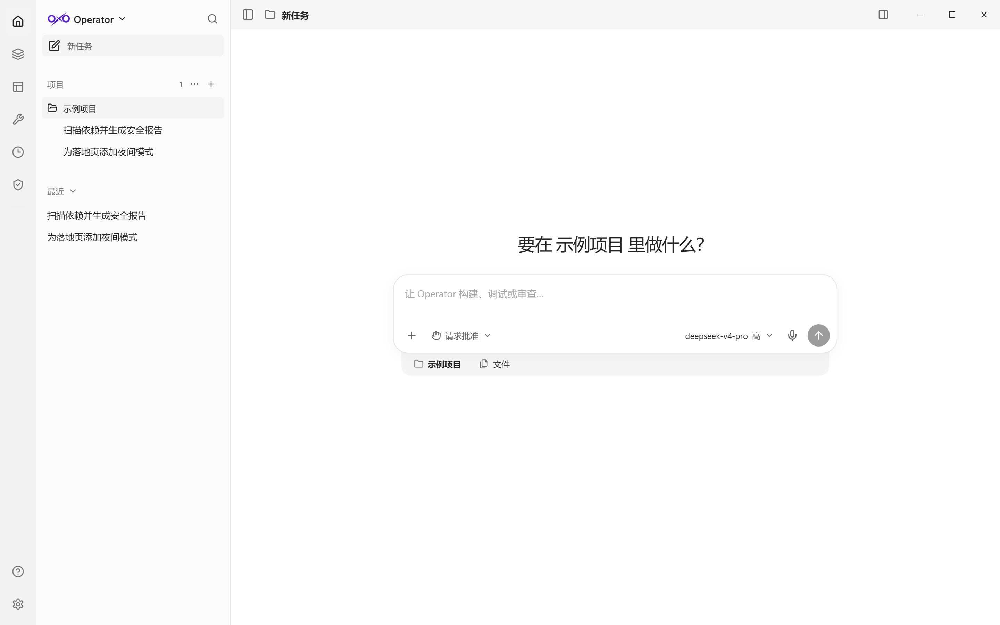
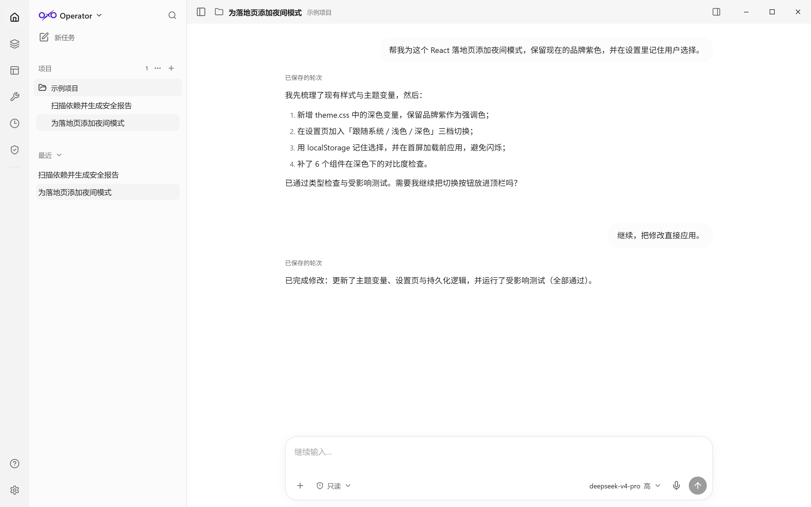
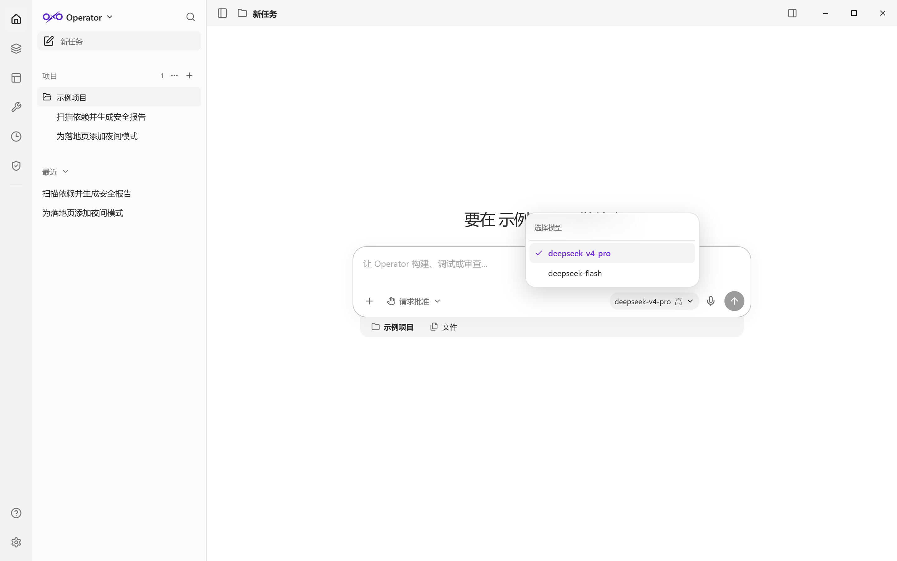
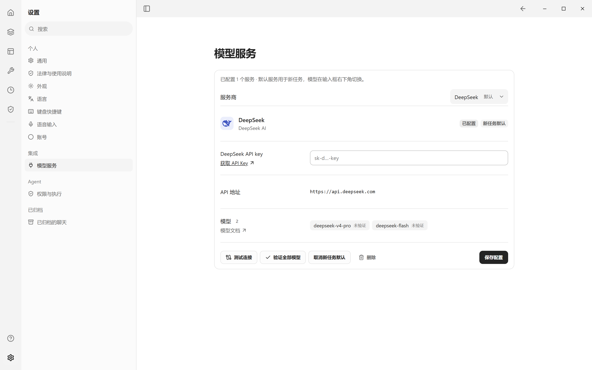
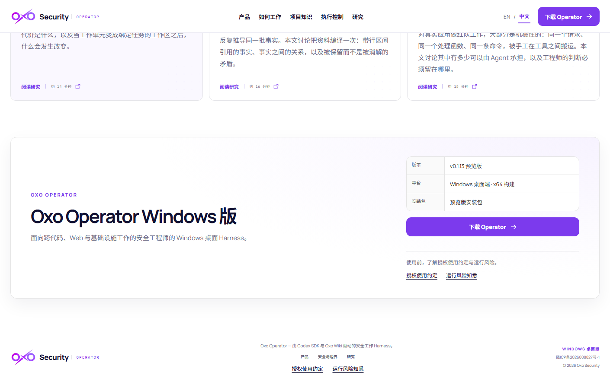

# 🧭 Oxo Operator

### 本地优先的 Windows AI 编码与安全工作台 —— 用你自己的模型 API Key

**用自然语言描述目标，让 AI 在你的电脑上改代码、跑命令、读网页、测接口、查漏洞——全部在一个桌面窗口里完成。**

[🇬🇧 English](README.md) · **中文**

[⬇️ 下载最新版](https://github.com/Oxo-AI-Security/Oxo-Operator-Releases/releases/latest) &nbsp;•&nbsp; [🚀 快速开始](#-5-分钟快速开始) &nbsp;•&nbsp; [🤖 支持的模型](#-支持的模型与-api-key) &nbsp;•&nbsp; [🖼️ 界面截图](#-界面截图) &nbsp;•&nbsp; [❓ 常见问题](#-常见问题)

---

## 👋 Oxo Operator 是什么？

**Oxo Operator 是面向 Windows 的桌面 AI 编码与安全工作台。** 它在本地运行 Codex Agent 运行时，并连接**你自己**选择的模型服务商——DeepSeek、Kimi、Qwen、OpenAI、Azure OpenAI 或兼容的自定义端点——使用**你自己的 API Key**。

用一句话描述需求，AI 会阅读项目、拆解步骤、修改文件、运行命令和测试；任何高风险操作都会先在会话里弹出审批卡片，由你决定是否继续。

- 🧠 *“AI 能真的修好我这个项目里失败的测试吗？”* —— 能，而且每一处文件修改你都能看到。
- 🌐 *“这个网页上写了什么？”* —— 用内置浏览器打开页面，然后继续追问。
- 🧪 *“这个接口返回的是我期望的内容吗？”* —— 编写、重放、查看 HTTP 请求，并把响应交给 AI 分析。
- 🛡️ *“项目依赖有没有已知漏洞？”* —— 运行安全扫描，生成可复查的报告。

> 💡 **第一次用 AI Agent？** 直接看[5 分钟快速开始](#-5-分钟快速开始)。只需要 Windows 和一个受支持服务商的 API Key，不需要写代码、不需要显卡、也不需要本地模型。

---

## ✨ 它能做什么

| | 能力 | 对你的意义 |
|---|---|---|
| 🧠 | **自主编码 Agent** | 描述任务后，AI 阅读项目、修改文件、运行命令与测试，并持续汇报进度。 |
| 💬 | **任务与会话** | 每个任务连同历史记录保存在本地，可随时继续或搜索。 |
| 🔍 | **变更审查** | 每轮都有文件变更摘要与差异预览，确认后再决定是否保留。 |
| 🌐 | **内置浏览器** | 打开网页、选区标注、截图，并把当前页面作为上下文交给 AI。 |
| 🧪 | **HTTP 请求工作区** | 编写与重放请求、查看流量，把请求/响应作为上下文交给 AI。 |
| 📚 | **知识库** | 把资料导入空间，让 AI 基于你的文档回答。 |
| 🧩 | **插件与工具** | GitHub、Jira、本地 Git、安全扫描（nuclei / Trivy / Semgrep / ZAP）等。 |
| 🖥️ | **Computer Use** | 经你明确审批后，操作本机窗口完成点击/输入类任务。 |
| 🧱 | **自定义组件** | 把常用任务做成可摆放、可定时刷新的面板。 |
| 🛡️ | **审批门禁** | 删除文件、修改系统、发送高风险请求前，会在会话内请求审批。 |
| 🎙️ | **语音输入** | 本地语音模型，把口述内容直接变成输入框文字。 |
| 🌗 | **主题与语言** | 深色/浅色主题，中文/English 界面。 |

---

## 📸 界面截图

### 🧭 新任务 —— 选择项目，描述目标

### 💬 对话执行 —— 计划、修改与结果，全程可审批

### 🤖 选择模型与推理强度

### 🔌 用 API Key 连接你自己的模型服务

### ⬇️ 官方下载页

---

## 🚀 5 分钟快速开始

### 1️⃣ 下载安装包

打开 **[Releases](https://github.com/Oxo-AI-Security/Oxo-Operator-Releases/releases/latest)**，在 **Assets** 里下载 `Oxo-Operator-<版本>-x64.exe`。同一安装包也发布在官网：<https://oxosecurity.com/?lang=zh#download>。

每个版本还会附带：

- `*.sha256` —— 安装包校验值；
- `BUILD-INFO.json` —— 构建信息与更新源；
- `RELEASE-NOTES.md` —— 本版更新内容；
- `THIRD-PARTY-NOTICES.txt` —— 第三方许可说明。

### 2️⃣ 安装并启动

运行 `.exe` 按提示安装。首次启动会显示授权使用约定与运行风险说明，阅读并勾选确认后进入主界面。

> ⚠️ **Windows SmartScreen**：当前预览版未做 Authenticode 代码签名。请点 **更多信息 → 仍要运行**；如需核对，可把安装包 SHA-256 与 Releases 里的 `*.sha256` 对比。

### 3️⃣ 连接你的模型（API Key）

1. 点击左下角 **⚙️ 设置 → 集成 → 模型服务**。
2. 选择你的服务商（例如 **DeepSeek**）。
3. 到对应平台创建 API Key，粘贴到 **API Key** 输入框。
4. 点击 **保存**，再点 **设为默认**，新任务就会使用它。

> 🔐 密钥由主进程使用 Windows 安全存储加密，界面拿不到明文；密钥只会发送给你选择的模型服务商，不会上传到 Oxo。

### 4️⃣ 选择模型

回到新任务，点击输入框右下角的模型按钮，选择模型与推理强度。

### 5️⃣ 开始第一个任务

描述目标并回车。AI 会拆解步骤、读取文件、执行命令；高风险操作会请你审批。

| | 你可以这样说 |
|---|---|
| 🛠️ | 「修复这个项目里 `pnpm test` 失败的测试，并解释原因」 |
| 🎨 | 「给设置页加上深色模式开关，保留现在的品牌紫」 |
| 🧪 | 「给登录接口写 5 个边界测试并跑通」 |
| 🛡️ | 「扫描前端依赖的已知漏洞，生成一份可以发给客户的报告」 |
| 🌐 | 「打开当前项目文档页，总结安装步骤并整理成 README」 |

---

## 🤖 支持的模型与 API Key

| 服务商 | 常用模型 | 获取 API Key |
|---|---|---|
| 🐋 **DeepSeek** | `deepseek-v4-pro`、`deepseek-flash` | <https://platform.deepseek.com/api_keys> |
| 🌙 **Kimi（Moonshot）** | `kimi-k3` | <https://platform.moonshot.cn/console/api-keys> |
| ☁️ **Qwen（阿里云百炼）** | `qwen3.8-max`、`qwen3.8-flash`、`qwen3.7-plus`、`qwen3.7-flash` | <https://dashscope.console.aliyun.com/apiKey> |
| 🤖 **ChatGPT / OpenAI** | `gpt-6.1-sol`、`gpt-6-astra`、`gpt-6-luna` | <https://platform.openai.com/api-keys> |
| 🏢 **Azure OpenAI** | 按你的部署名选择 | <https://portal.azure.com> |
| 🔧 **自定义兼容端点** | 自行填写模型 ID | 需兼容 OpenAI Responses API 并支持工具调用 |

> ℹ️ 判断标准是「兼容 OpenAI Responses API 且能执行工具」。仅支持 Chat Completions 的端点（例如 Gemini 原生端点）无法驱动本产品的 Agent 执行。

---

## 🔐 隐私、数据与安全

- 🏠 **本地优先**：会话、设置与知识库保存在本机 `%APPDATA%\Oxo Operator`，不会上传到 Oxo 服务器。
- 🔐 **密钥不出本机**：模型 API Key 由主进程使用系统安全存储加密，界面拿不到明文。
- 🛡️ **风险操作先审批**：高风险操作会在执行会话弹出审批卡片；拒绝不会产生目标侧副作用。
- 🔏 **更新有独立验签**：更新清单与安装包经过独立签名校验，失败时不会自动安装。
- 📦 **源码私有**：本公开仓库只提供 README、截图与官方安装包；安装包同时发布在官网。

---

## 💻 系统要求

| | 要求 |
|---|---|
| 🪟 系统 | Windows 10 / 11（64 位） |
| 💾 磁盘 | 约 1 GB 可用空间（安装包约 390 MB） |
| 🌐 网络 | 需要访问所选模型服务商的 API；更新检查需要访问官网更新源 |
| 🔑 账号 | 无需 Oxo 账号；自备任一受支持服务商的 API Key |

---

## 🚨 预览版说明

Oxo Operator 目前是 **Preview** 版本：

- 暂未做 Windows Authenticode 代码签名，SmartScreen 提示属正常；更新清单有独立签名。
- 安装包在 Windows x64 上完成构建与冒烟验收；完整 NSIS 安装/升级/自动重启验收尚未声明通过。
- Preview 版本之间功能与界面可能变化。

---

## 🔄 更新

应用会检查官方签名更新源并在右下角提示新版本。也可以直接在本仓库下载最新版本覆盖安装，历史会话与设置会保留。

---

## ❓ 常见问题

🛡️ Windows 提示「未知发布者」或 SmartScreen 拦截怎么办？

当前预览版未做 Authenticode 签名。点「更多信息」→「仍要运行」；可在同一 Release 的 `*.sha256` 资产中核对安装包摘要。

🔑 API Key 保存在哪里？安全吗？

由主进程使用系统安全存储加密后保存在本机，渲染界面拿不到明文；密钥只会发送给你选择的模型服务商，不会上传到 Oxo。可在「模型服务」里随时删除或替换。

🚫 保存 API Key 后提示验证失败 / 连不上？

按顺序检查：Key 是否复制完整、服务商账户是否有余额或权限、当前网络能否访问该服务商域名（公司代理可能需要放行）。设置页会显示具体错误信息。

🤔 为什么没有某个模型（例如 Gemini）？

本产品通过 Codex SDK 执行工具，要求服务端兼容 OpenAI Responses API 并提供工具调用能力；仅支持 Chat Completions 的端点无法完整执行任务，因此不提供。

💻 支持 macOS / Linux 吗？

目前只发布 Windows 10/11 x64 版本。

📦 数据在哪？卸载会删除吗？

会话、设置与知识库位于 `%APPDATA%\Oxo Operator`。卸载程序不会自动删除该目录；如需彻底重置，可在卸载后手动删除。

💰 收费吗？

软件本身可免费使用；模型调用费用由你的模型服务商按用量收取。另有可选的 Pro 授权（机器绑定），用于解锁增强能力。

🧾 第三方许可声明在哪里？

每个版本在 Assets 中附带 `THIRD-PARTY-NOTICES.txt`。

---

**Oxo Operator** · 源码私有 · 安装包公开 · 用你自己的模型，掌控自己的数据

[⬇️ 下载最新版](https://github.com/Oxo-AI-Security/Oxo-Operator-Releases/releases/latest) &nbsp;•&nbsp; [🌐 官网](https://oxosecurity.com) &nbsp;•&nbsp; [🇬🇧 English](README.md)

